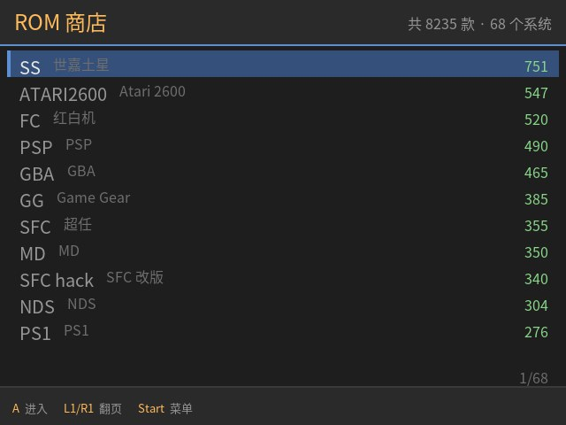
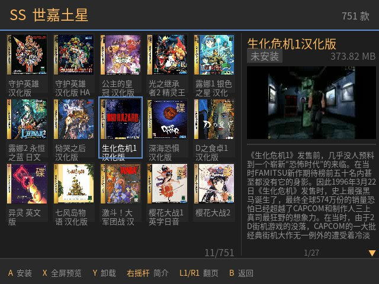
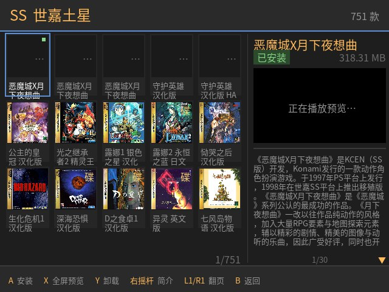

# ROM 商店 —— 掌机上的局域网游戏商店

在 **ArkOS4Clone（R36S / R36 Ultra 等）** 掌机上直接浏览 NAS 上的游戏库，
选中就装到本机，装完即出现在 EmulationStation 里。全中文界面，
**不需要电脑中转、不需要手机 App**。

- 数据源：NAS 上一个 SMB 共享，**不需要在 NAS 上装任何服务**
- 客户端：掌机自己是唯一客户端，元数据缓存 + 索引都在掌机上
- 界面：SDL2 图形界面，640×480，手柄操作
- 依赖：系统自带的 Python 3 + SDL2，**零 pip 包**

---

## 界面长什么样

以下截图**全部是从真机（`r36s`）上直接抓帧导出的**，不是设计稿。
640×480 就是掌机的原生分辨率。

### 系统页：68 个系统，按游戏数量排序



### 游戏页：左边封面卡片网格，右边选中游戏的详情

一屏 5 列 × 3 行共 15 款。右边常驻显示标题、安装状态、**ROM 文件大小**、
**视频预览**和简介 —— **不用按 `A` 进详情页**。



- 选中卡片是**边框高亮**（不是蓝底色块），已安装的右上角有绿点
- 卡片封面、视频、简介、文件大小都是**后台慢慢加载**的，进系统时可能还空着，一两秒填满
- 视频直接**串流播 NAS 上的源文件**，不复制到掌机；`X` 键全屏预览

### 视频加载中的样子

刚切到某个游戏、视频还在拉流时，右栏显示占位提示；封面已全部就位：



---

## 一、前置条件

### 掌机

- ArkOS4Clone 系统（或同源的 aarch64 ArkOS 分支），用户 `ark`
- 有 SSH（安装时要用），或能用 U 盘把安装包拷进去
- 与 NAS 在同一局域网

### NAS（或任何一台开着 SMB 的机器）

只要求一件事：**开着 SMB（445 端口），开一个共享，把游戏目录放进共享根下。**
NAS 上**不需要装任何服务**，本程序**只读不写**，不会往 NAS 上放任何东西。

#### 目录怎么摆

**规则只有一条：每个平台一个「顶层目录」，里面放一份 `metadata.pegasus.txt`。**

```
Roms/                            ← 这是 SMB 共享名，随便叫什么都行
├── FC/                          ← 顶层目录 = 一个平台
│   ├── metadata.pegasus.txt     ← 【必须】文件名必须一字不差，见下
│   ├── media/                   ← 【可选】素材目录，见下
│   │   └── 1943/
│   │       ├── boxFront.jpg     ← 封面（安装时复制到掌机）
│   │       ├── logo.png         ← 标题图
│   │       └── video.mp4        ← 预览视频（不复制，直接串流播）
│   ├── 超级马里奥.nes           ← ROM 文件，位置随意
│   ├── 1943.zip
│   └── ...
├── SFC/                         ← 另一个平台
│   └── metadata.pegasus.txt
├── PSP/
│   └── metadata.pegasus.txt
└── ...
```

**几个容易踩的点：**

| 要求 | 说明 |
| --- | --- |
| 平台目录必须在**共享根下** | 不能是 `Roms/roms/FC/` 这种嵌套。程序只扫共享根的**一层**子目录 |
| 文件名必须**一字不差** | `metadata.pegasus.txt`（全小写、`.txt` 后缀）。写成 `metadata.txt` / `pegasus.txt` / `METADATA.PEGASUS.TXT` 都不会被识别 |
| 目录名用什么随意 | 常见短名最好：`FC` `SFC` `GBA` `PSP` `MD` `PS1` `SS` `DC` `3DO`… **认不出来这个平台会被跳过**，见本节末尾 |
| ROM 可以放在子目录里 | 如 `D no Shokutaku/xxx.chd`，`metadata` 里的 `file:` 写相对路径即可 |
| 共享名无所谓 | 装的时候填你实际的共享名（默认 `Roms`） |

> **只有一个平台目录行不行？** 行。放一个也能用，只是商店里只有一个系统可选。

#### `metadata.pegasus.txt` 怎么写

这是**唯一必须自己准备的文件** —— 它是游戏清单，程序靠它才知道有哪些游戏。
格式是 [Pegasus _metadata](https://pegasus-assets.org/metadata)（标准 YAML，程序只读其中几个字段）。
最小可用版本长这样：

```yaml
collection: FC                      # 文件头：平台名，随便写，不影响功能
sort-by: 001

game: 1943                         # 【必须】游戏标题，显示在商店里
file: 1943.zip                     # 【必须】ROM 相对路径（单文件）
description: 1943年，是 Capcom 的经典纵版射击游戏。
developer: Capcom

game: 超级马里奥兄弟3
file: 超级马里奥兄弟3.zip
```

**字段说明：**

| 字段 | 必须 | 说明 |
| --- | :---: | --- |
| `game:` | ✅ | 游戏标题。商店里显示的名字就是它 |
| `file:` | ✅¹ | ROM 的相对路径。**单文件游戏用它** |
| `files:` | ✅¹ | 多碟游戏用这个代替 `file:`，下面每行缩进写一个碟 |
| `description:` | | 简介，显示在右栏。省略就没有简介 |
| `assets.box_front:` | | 封面相对路径。**可以省略** —— 程序会自动按 `media/<ROM名>/` 推导 |
| `developer:` `genre:` `players:` `release:` | | 补充信息，程序目前不显示，但留着不亏 |
| `collection:` `sort-by:` `launch:` `extensions:` | | 文件头块，程序会跳过；保留是 Pegasus 的标准写法 |

> ¹ 每个游戏必须有 `file:` 或 `files:` 其中之一，否则这个游戏会被跳过。

**多碟游戏**用 `files:`（缩进表示继续行）：

```yaml
game: 宇宙冒险家
files:
  Daedalus Encounter/Daedalus Encounter (Disc 1).chd
  Daedalus Encounter/Daedalus Encounter (Disc 2).chd
  Daedalus Encounter/Daedalus Encounter (Disc 3).chd
description: 1990 年的太空飞行模拟。
```

装这类游戏时会自动生成 `.m3u` 播放列表，ES 能正确读多碟。

#### 素材目录（可选，但强烈建议）

封面和预览视频都放在平台目录下的 `media/` 里，**子目录名 = ROM 文件名去掉扩展名**：

```
FC/1943.zip                ← ROM
FC/media/1943/boxFront.jpg ← 封面
FC/media/1943/video.mp4    ← 预览视频
```

这条对应关系让程序能**直接推导**素材路径，不需要遍历几万个子目录（实测遍历要 24.8 秒，推导是 0 秒）。

- **素材目录名**：默认认 `media/`，也兼容 `img` / `images` / `image` / `covers` / `boxart`
- **封面文件名**：认 `boxfront` / `box_front` / `box` / `cover` / `front` / `folder` 等，
  扩展名认 `.png` `.jpg` `.jpeg` `.webp`，**全部大小写不敏感**
  （实测同一目录里 `boxFront.jpg` 和 `boxfront.jpg` 并存，硬拼路径会静默读不到）
- **兜底**：上表全都没有时，会取该目录下第一张「像封面」的图片
- **没有素材不算错误**：游戏照样能列出、能安装，只是没封面没预览

> 程序找素材时用的是 **ROM 真实所在的那个平台目录**，不是清单里写的那个。
> 同一份清单被拆到两个目录时（`SS` / `SS plus`、`PS1` / `PS1 hack` 等都这样）也能找对。

#### 目录名认不出来怎么办

程序内置一张 **68 条**的映射表，把 NAS 目录名翻成 EmulationStation 的系统名：

| NAS 目录 | ES 系统名 | | NAS 目录 | ES 系统名 |
| --- | --- | --- | --- | --- |
| `FC` | `nes` | | `PSP` | `ppsspp` |
| `SFC` | `sfc` | | `MD` | `megadrive` |
| `GBA` | `gba` | | `PS1` | `psx` |
| `DC` | `dreamcast` | | `SS` | `saturn` |
| `3DO` | `3do` | | | |

**注意两边名字往往不一样** —— `FC` 对应的 ES 系统叫 `nes` 而不是 `fc`，
`PSP` 叫 `ppsspp`，`DC` 叫 `dreamcast`。所以**别按 ES 的名字建 NAS 目录**，
按常见短名建就行。

⚠️ **目录名不在表里，这个平台就整个被跳过** —— 游戏不会被索引，商店里看不到。
如果你换了新的 ROM 包、某个平台突然消失了，先跑校验（它会同时核对
映射表、ES 配置和 NAS 实际目录）：

```bash
python3 -m romstore.cli --validate   # 校验映射表 / ES 配置 / NAS 目录
python3 -m romstore.cli --systems    # 列出识别成功的平台及其游戏数
python3 -m romstore.cli --list FC    # 看某个平台下的游戏
```

对策：把目录名改成表里已有的名字。表里没有的话，在
`src/romstore/mapp.py` 的 `MAP` 里加一行：

```python
('你的目录名', 'es系统名', '/roms/es系统名', 'ok', '中文说明'),
```

---

## 二、安装

### 1. 把安装包传到掌机

```bash
# 在你的电脑上
scp ark-romstore-0.5.0.tar.gz ark@<掌机IP>:/tmp/
# 或 scp -r 整个 ark-romstore/ 目录
```

### 2. 解包并安装

```bash
ssh ark@<掌机IP>
cd /tmp
tar xzf ark-romstore-0.5.0.tar.gz
cd ark-romstore-0.5.0

# 先干跑一遍，只看环境够不够，不动任何文件
sudo ./install.sh --check

# 正式安装（把 NAS 地址和共享名填上）
sudo ./install.sh --host 10.168.1.100 --share Roms
```

> 缺依赖（最常见是 `cifs-utils`）时安装器会**自动 `apt-get` 补装**，
> 不必自己上去敲。想让它只报错不动手，加 `--no-auto-apt`。
> `--check` 是干跑，一律不补装。


> 若提示 `Permission denied`（从 Windows 解压、或经 U 盘拷贝时常见，
> 可执行位丢了），改用 `sudo bash install.sh ...` 即可，不用先 `chmod`。

NAS 需要账号时：

```bash
sudo ./install.sh --host 10.168.1.100 --share Roms \
                  --smbuser myuser --smbpass mypassword
```

不想用命令行也行：**不带 `--host` 直接装**，然后用内置默认装起来，
再到掌机上按 `Start` →「修改商店源」改对（见第四节）。

安装器会做这些事，每一步都会打印结果：

1. 定位目标用户；**没给 `--es-dir` 时自动从 `es_systems.cfg` 探测 options 目录**
2. 检查依赖（python3 / mount.cifs / flock / nc / SDL2 / SDL2_ttf / 中文字体 /
   **内核 cifs 支持**）—— 可自动补装的缺项会**自己 `apt-get` 装上**，
   内核不支持这类没法补的才停下
3. 备份会被覆盖的文件到 `~/.romstore/backup/<时间戳>/`（全新安装会说"无旧文件"）
4. 装程序到 `~/.romstore/`，入口脚本到 ES 的 options 目录
5. 生成挂载脚本到 `/usr/local/sbin/nas-roms-mount.sh`
6. 写 `source.json`（密码不进命令行，走环境变量）
7. 装并启用 `nas-roms.service`（开机自动挂 NAS）+ NetworkManager dispatcher
8. 挂载 NAS、建索引（首次约 10–15 秒）
9. 注册 EmulationStation 入口
10. **安装后自检**：程序本体 / 入口脚本 / gamelist 条目 / `source.json` /
    挂载 / 索引 / 开机自启 + 一次无头探针（SDL / 手柄 / 中文字体），
    最后给出「全部通过」或「N 项未通过」

> `--check` 是干跑：只做第 2 步的检查，不写任何文件、也不补装依赖。

### 3. 升级

同一个安装包再跑一次即可，**幂等**：

```bash
sudo ./install.sh --host 10.168.1.100 --share Roms
```

源码被覆盖，`source.json`、索引、已装的游戏都保留。

---

## 三、使用

掌机上：**EmulationStation → Options → 「ROM 商店」**

> 如果 Options 里看不到，重启一次 EmulationStation 就会刷新出来。

| 动作 | 按键 |
| --- | --- |
| 移动（网格内上下左右） | 十字键 / 左摇杆 |
| **安装** | **`A`** |
| **全屏播放预览视频** | **`X`** |
| 卸载 | `Y` |
| **滚动右栏简介** | **右摇杆上下** |
| 返回 | `B` |
| 上下翻页 | `L1` / `R1` |
| **功能菜单** | **`Start`**（`Select` 等效） |

**游戏页是一屏看完的**（0.5.0 起）：左边是封面卡片网格，右栏是选中游戏的
标题、安装状态、**视频预览区**和简介。**没有单独的详情页** —— 移动光标，
右栏跟着变；要装或要播，按 `A` 或 `X` 就行，不用先进详情页。

卡片上已安装的游戏右上角有一个**绿点**，扫一眼就知道哪些装过了。
选中项用**亮边框**框出（不铺色块），封面始终完整可见。

右栏从上到下依次是**标题 → 安装状态 → 视频预览区 → 简介正文**。
简介比较长时用**右摇杆上下滚动**，右下角有 `3/12` 这样的行号和 ▲▼ 箭头
提示还剩多少。左摇管移动、右摇管滚动，两者互不干扰。

**按 `X` 全屏播放预览视频**。NAS 上每个游戏的素材目录
`<系统>/media/<ROM 名>/video.mp4` 就是它的过场演示，商店会直接串流播放，
**不下载、不占本机空间**。播放时商店会先退出界面（EmulationStation 独占显示与音频设备），
用 `mpv` 直出 DRM **全屏**播放；按 `B` 或播放结束会**自动回到刚才那张卡片**。

> 封面和简介是**后台慢慢加载**的（一屏 15 张封面要从 NAS 现读），
> 刚进系统时卡片可能还是空的，等一两秒就填满，期间界面不会卡。
>
> 底栏会标明当前游戏有没有片源：有片源显示「X 全屏预览」，没有则显示「X 无预览」。

**Start 菜单**里有三项：

- **重扫 NAS** —— NAS 上加了新游戏后，用它刷新索引
- **修改商店源** —— 换 NAS / 换共享 / 换账号（见下节）
- **退出商店**

> 退出与重扫都收在 Start 菜单里，而不是绑在某个键上直接触发 ——
> 一是 `Start` 在 ArkOS 里本来就是菜单键，二是这样顺带避免了误触退出。

安装时会显示进度（检查空间 → 复制文件 → 生成播放列表 → 写入游戏列表），
装完自动出现在 ES 的游戏列表里，不需要手动刷新。

**空间不够会拒绝安装**并告诉你要多少；**卸载会进回收站**
（`/roms/.romstore-trash/<时间戳>/`），不是直接删。

---

## 四、换商店源（不用电脑）

`Start` → **修改商店源** → 四个字段：主机 / 共享名 / 账号 / 密码。

- `A` 编辑当前字段（调出手柄软键盘）
- `X` **扫描局域网**，列出开着 445 端口的主机，直接选一个当主机
- `B` 返回
- 选到「保存并连接」按 `A` —— 会立刻重挂载并重建索引

**软键盘**（掌机没有物理键盘，这是唯一输入方式）：

| 动作 | 按键 |
| --- | --- |
| 选字符 | 十字键 |
| 输入 | `A` |
| 退格 | `Y` |
| 完成 | `X` |
| 切页（数字 / 小写 / 大写 / 符号） | `L1` / `R1` |
| 取消 | `B` |

> 软键盘**故意不提供逗号** —— cifs 的挂载选项是逗号分隔的，
> 账号或密码里带逗号会让整条 `-o` 串错位。程序另外还会再剔除一次。

改完会写到 `~/.romstore/source.json`（权限 600）。
**开机挂载脚本读的是同一个文件**，所以「商店里改的源」和
「开机挂的源」永远一致。

万一这个文件丢了或写坏了，挂载脚本会回落到内置默认值
（`10.168.1.100 / Roms / 匿名`）—— **宁可挂错也不能开机挂不上**，
装错了可以在商店里改回来。

---

## 五、命令行工具（排障用）

```bash
cd ~/.romstore

# 环境自检：视频驱动 / 屏幕 / 手柄 / 字体 / NAS / 索引
python3 run.py --probe

# 映射表与 ES 配置是否对得上
python3 -m romstore.cli --validate

# 索引
python3 -m romstore.cli --stats
python3 -m romstore.cli --systems
python3 -m romstore.cli --list FC --page 1
python3 -m romstore.cli --search 马里奥
python3 -m romstore.cli --detail <game_id>
python3 -m romstore.cli --build          # 增量重建
python3 -m romstore.cli --build --force  # 全量重建

# 商店源
python3 -m romstore.cli --source-show
python3 -m romstore.cli --source-set 10.168.1.100,Roms
python3 -m romstore.cli --scan-hosts            # 扫本机网段的 445
python3 -m romstore.cli --mount --force         # 按当前源强制重挂
python3 -m romstore.cli --umount

# 安装 / 卸载（无界面）
python3 -m romstore.cli --install <game_id> --dry-run
python3 -m romstore.cli --install <game_id>          # 连封面一起导入
python3 -m romstore.cli --install <game_id> --no-media   # 只装 ROM，跳过封面
python3 -m romstore.cli --remove <game_id>

# ES 入口
python3 -m romstore.cli --register
python3 -m romstore.cli --unregister
```

---

## 六、文件都装到哪了

| 路径 | 是什么 |
| --- | --- |
| `/opt/system/RomStore.sh` | ES 入口（rootfs，换 SD 卡不影响） |
| `/usr/local/sbin/nas-roms-mount.sh` | 幂等挂载脚本（原文件备份为 `.orig-bak`） |
| `/etc/systemd/system/nas-roms.service` | 开机自动挂载 |
| `/etc/NetworkManager/dispatcher.d/50-nas-roms` | 网络重连时补挂 |
| `~/.romstore/run.py` `~/.romstore/romstore/` | 程序本体 |
| `~/.romstore/source.json` | 商店源（600） |
| `~/.romstore/index.db` | 索引（实测 8,210 款游戏约 1.76 MB） |
| `~/.romstore/backup/<时间戳>/` | 安装时被覆盖文件的备份 |
| `~/.romstore/log/run.log` | 运行日志 |
| `/mnt/Roms` | NAS 挂载点（**固定**，`es_systems.cfg` 里所有路径都指向它） |
| `/roms/.romstore-trash/` | 卸载回收站 |

---

## 七、排障

### ES 里看不到「ROM 商店」

重启一次 EmulationStation。如果还是没有：

```bash
md5sum /opt/system/RomStore.sh        # 应该存在
cat /opt/system/gamelist.xml | grep RomStore
ls -l /etc/emulationstation/es_systems.cfg
grep -A2 '<name>options</name>' /etc/emulationstation/es_systems.cfg
# 确认 <path> 与 --es-dir 一致
```

### 界面能开但列表是空的

NAS 没挂上，或索引没建：

```bash
mount | grep /mnt/Roms
ls /mnt/Roms | head
python3 -m romstore.cli --source-show
python3 -m romstore.cli --mount --force
python3 -m romstore.cli --build
```

### 挂载失败

`--source-show` 会直接告诉你原因，例如
`mount error(2): No such file or directory` 就是共享名不对，
`mount error(13): Permission denied` 是账号密码问题。

排查顺序：

```bash
# 1. 主机通不通、445 开没开
python3 -m romstore.cli --probe-host 10.168.1.100
# 2. 共享名对不对（注意区分大小写）
python3 -m romstore.cli --source-show
# 3. 手动看内核报错
sudo /usr/local/sbin/nas-roms-mount.sh --force
```

已知的兼容性硬约束（改脚本时别动）：**内核 cifs 只认 `vers=2.1`**，
`vers=2.0` 会返回 `EOPNOTSUPP`。

### 界面里中文是空白方块

缺中文字体。`consolefonts` 里的控制台字体**最大只有 14.6 KB，没有 CJK 字形**，
所以不要试图改控制台字体，装字体才对：

```bash
sudo apt-get install fonts-noto-cjk
```

### 手柄没反应

```bash
python3 run.py --probe        # 看「手柄数量」是不是 0
ls -l /opt/inttools/gamecontrollerdb.txt
```

`SDL_GAMECONTROLLERCONFIG_FILE` 由 `RomStore.sh` 导出，指向
`/opt/inttools/gamecontrollerdb.txt`（ArkOS 固件自带）。文件不在就说明
这不是标准 ArkOS。

### ES 反复重启 / 屏幕一直闪

这是 EmulationStation 自己崩了，被 `Restart=on-failure` +
`RestartSec=100ms` 放大成死循环，与本商店无关但很容易同时踩到。
装上崩溃上限保护即可：

```bash
sudo ./install.sh --with-es-guard
# 或手动
sudo install -D -m 644 extras/10-crash-limit.conf \
    /etc/systemd/system/emulationstation.service.d/10-crash-limit.conf
sudo systemctl daemon-reload
```

效果：120 秒内最多重启 5 次，仍失败就彻底停下并留控制台，
不再无休止空转写 SD 卡。**不改厂商原始的 unit 文件**。

需要确认到底崩在哪时：

```bash
# 打开 ES 日志
sudo sed -i 's|name="LogLevel" value="disabled"|name="LogLevel" value="debug"|' \
    /home/ark/.emulationstation/es_settings.cfg
sudo journalctl -u emulationstation -b --no-pager | tail -40
```

### 界面卡住 / 黑屏

`RomStore.sh` 会在退出时连子进程一起收掉，正常情况下不会留下孤儿进程。
真有残留：

```bash
ps -eo pid,args | grep 'romstor[e]/run.py'
sudo pkill -9 -f 'romstore/run[.]py'
```

> 注意 `pkill -f` 的模式写法 —— 用 `romstore/run[.]py` 而不是
> `romstore/run.py`，否则这条命令自己的命令行里含有该字符串，
> 会把执行命令的 shell 一起杀掉。

---

## 八、卸载

```bash
cd /tmp/ark-romstore-0.5.0

sudo ./uninstall.sh --check        # 先看会删什么
sudo ./uninstall.sh                # 卸商店 + NAS 挂载服务，保留配置与索引
sudo ./uninstall.sh --keep-mount   # 只卸商店，保留 /mnt/Roms 挂载
sudo ./uninstall.sh --purge        # 连索引/配置/日志/备份一起删
```

卸完会**自动自检**是否有残留（文件 / 挂载 / 菜单条目），逐条列出。

**已下载的游戏文件不受影响** —— 它们在 `/roms/` 下，卸载脚本不碰。

---

## 九、已知边界

- **封面/logo 会自动导入**（0.4.0 起，0.4.1 修正布局）。装完的游戏在 ES 里就有图：
  NAS 上 `media/<游戏名>/boxFront.jpg` 会被复制过来并写进 gamelist 的 `<image>`。
  **掌机上素材有两套布局，程序会先探测再按同款写**（见下方「刮削素材布局」）：
  - 散文件式：`/roms/nes/img/1943.png`
  - 每游戏子目录式：`/roms/gba/media/黄金太阳/boxfront.png`

  **视频（`video.mp4`）会复制到掌机吗？不会** —— 它是**直接串流播 NAS 上的源文件**，
  不占 SD 空间、不占下载时间（SD 写速只有 4.8 MB/s，1.75 GB 的镜像要 6 分钟）。
  游戏页按 `X` 就能预览。
  没有封面的游戏静默跳过，**不算安装失败**。想只装 ROM 可用 `--no-media`。
- **卸载回收站不会自动清理**，需要手动删 `/roms/.romstore-trash/`。
- **账号密码走明文 NTLM**（SMB 2.1 协议使然），家用局域网够用，
  **不要暴露到公网**。
- **列不出「这台主机上有哪些共享」** —— 掌机上没装 `smbclient`
  （装了会拖进一堆依赖），所以扫描只能告诉你哪些主机开着 445 端口，
  共享名需要手输。Pegasus 侧建议固定用 `Roms` 这类好记的名字。
- **挂载点固定 `/mnt/Roms`**，不可配置 —— `es_systems.cfg` 里
  128 个系统的 `<path>` 都指向它。
- **多碟游戏**（`.m3u` 生成那条分支）代码已实现，但**没用真实多碟游戏验证过**。
  （**单文件大游戏已验证**：854 MB 的 PSP ISO 装完 md5 与 NAS 源逐字节一致。）
- **MAME 的 9 个分类目录**目前映射到 `mame2003`，属于推测，需要实机确认。
- **ES 装完新游戏后是否自动重扫**尚未验证 —— 如果没自动出现，
  用 `Start` →「重扫 NAS」，或在 ES 里退出重进。

---

## 十、目录结构

```
ark-romstore/
├── README.md            本文件
├── VERSION              版本号
├── CHANGELOG.md         更新日志
├── RELEASE-NOTES.md     版本说明（装机前先看这份）
├── install.sh           一键安装 / 升级
├── uninstall.sh         卸载
├── make-dist.py         打包成 tar.gz / zip（维护者用）
├── src/                 程序本体（原样部署到 ~/.romstore/）
│   ├── RomStore.sh         ES 入口（模板）
│   ├── run.py              入口（--probe / --display-test / 无头模式）
│   ├── nas-roms-mount.sh   幂等挂载脚本（模板）
│   └── romstore/
│       ├── config.py       路径常量
│       ├── mapp.py         NAS 目录 → ES 系统 映射表（68 条，含置信度）
│       ├── meta.py         Pegasus metadata 解析
│       ├── media.py        刮削素材（封面）路径推导与复制
│       ├── index.py        L1 索引 + 指纹增量
│       ├── install.py      空间预检 + 流式复制 + 封面导入 + gamelist 文本级 upsert
│       ├── source.py       商店源读写 / 主机扫描 / 挂载
│       ├── sdl.py          SDL2 的 ctypes 绑定（含封面缩略图缓存）
│       ├── ui.py           界面
│       ├── cover.py        封面/简介/文件大小 后台加载
│       ├── vplayer.py      右栏视频串流播放（mpv 接力）
│       └── cli.py          无头命令行
├── systemd/
│   ├── nas-roms.service    开机挂载单元
│   ├── roms-fs-selfheal.service  /roms 只读时开机自动修复
│   ├── roms-fs-watch.service    /roms 运行期只读监控（发现后转交自愈）
│   └── 50-nas-roms         NetworkManager dispatcher
└── extras/
    └── 10-crash-limit.conf ES 崩溃循环上限保护（可选，--with-es-guard）
```

`src/RomStore.sh` 与 `src/nas-roms-mount.sh` 里带
`@@STORE_DIR@@` / `@@ES_DIR@@` / `@@UID@@` / `@@GID@@` 占位符，
由 `install.sh` 按实机情况替换；替换不干净安装器会直接报错退出。
所以这两个文件**不能直接拷到机器上跑**。

### 怎么打这个包

```bash
cd ark-romstore
python3 make-dist.py --list      # 先看会打哪些文件、各自的权限位
python3 make-dist.py             # 产出 ../ark-romstore-<版本>.tar.gz 与 .zip
python3 make-dist.py -o /tmp/d   # 指定输出目录
python3 make-dist.py --epoch 1750000000   # 可复现构建（固定所有时间戳）
```

输出目录里还会生成 `SHA256SUMS`（对应 tar.gz 与 zip）。
它**不能**放进包里 —— 那样哈希会自我引用。验证：

```bash
sha256sum -c SHA256SUMS
```

打包脚本只做三件事，但每件都踩过：

1. **统一收进 `ark-romstore-<版本>/` 前缀** —— 否则解包时会散落在当前
   目录（tar bomb）。
2. **按规则写死权限位**（`*.sh` / `make-dist.py` / `systemd/50-nas-roms`
   为 `755`，其余 `644`）—— **不能靠宿主文件系统**：在 Windows 上打出来的
   `install.sh` 是 `0666`，掌机上 `./install.sh` 直接 `Permission denied`。
   zip 侧还额外设了 `create_system=3`，否则解压方不认 `external_attr` 里的权限。
3. **排除 `__pycache__` / `*.pyc`** —— 那是打包机的 Python 版本产物，
   掌机是 Python 3.7，带过去既没用又可能让人误判。

`--epoch` 要同时钉住**两层**时间戳：tar 条目的 mtime，以及 **gzip 容器头部
的 mtime**。后者最容易被漏——`tarfile.open(mode='w:gz')` 内部用
`time.time()` 且不接受 mtime 参数，背靠背跑两次常常落在同一秒，
于是「md5 一致」是巧合而非可复现。脚本里是自己套一层 `GzipFile` 传
`mtime` 解决的。

打之前脚本会自检：必备文件在不在、两个模板里的 `@@STORE_DIR@@`
占位符还在不在（缺了说明模板被误渲染过）。

> 万一手上的包解出来 `install.sh` 没有可执行位（从 Windows 解压再拷进
> U 盘常见），用 `sudo bash install.sh` 一样能装，不必先 `chmod`。

---

## 十一、技术要点（为什么这么写）

供维护者参考，细节见同目录的技术架构文档。

- **`es_systems.cfg` 不是合法 XML** —— options 系统的 `<command>` 里有裸 `&`
  （`2>&1`），直接喂给 ElementTree 会解析出 **0 个系统**。解析前必须先做实体转义。
- **gamelist 用文本级插入，不重新序列化** —— 实机上 `nes/gamelist.xml` 是纯
  CRLF、`psp/gamelist.xml` 是纯 LF，格式并不统一，一旦重新序列化就会破坏
  原有上千条目的字节序列。插入时逐文件探测换行风格，插入点取
  `</gameList>` 之前且不 `rstrip`。安装→卸载一个来回后 md5 能回到原值。
- **不用控制台 UI（dialog）** —— 实机 `consolefonts/` 最大字体仅 14.6 KB，
  无 CJK 字形，中文全变空白；且 fbcon 不支持双宽字形。SDL2 是唯一可行路线。
- **不用 gptokeyb** —— 那是控制台程序的「手柄转键盘」桥。本程序直接读
  SDL 手柄事件，不经过键盘这一层。
- **挂载必须共用同一把锁** —— systemd、NetworkManager dispatcher、
  商店换源三处都会调用挂载脚本，无锁时第二个会
  `mount error(16) Device or resource busy`。统一用 `/run/nas-roms.lock` +
  `flock -w 120` 串行化。
- **`cache=loose,actimeo=60`** —— 属性缓存从默认 1 秒放宽到 60 秒，
  目录遍历类操作实测快约 40%（慢速 WiFi 链路上尤其明显）。
